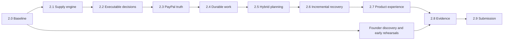

# FarmBroker AI — 2.0–2.9 engineering and competition roadmap

Planning date: October 15, 2026. Reviewed application: `ce3d468`. **Everything in this roadmap is proposed. Unchecked work is not shipped functionality.**

## The recommendation

Build a procurement operator whose AI decisions become executable contracts, whose money and stock remain correct under retries, and whose interface stays responsive while external providers take time.

The useful combination is:

1. **AI interpretation + deterministic optimization:** AI turns the buyer's messy brief into a confirmed specification and selects among meaningful feasible plans. Code owns quantities, economics, and permission.
2. **Read-only preparation + authoritative execution:** compute plans before payment; commit the selected plan only after verified capture and a fresh stock check.
3. **Transactional core + durable workers:** Postgres owns invariants; native jobs handle slow model/payment calls and recovery.
4. **Strong writes + fast reads:** small versioned order summaries serve the product; commands recheck current truth.
5. **Incremental repair + explicit exposure:** preserve accepted stock, repair the shortage, retain the buyer's fixed price, and show the platform's obligations.

These are established techniques combined for this domain. We should demonstrate a distinctive implementation through measured behavior rather than claim a new distributed-systems invention or a world first.

## Identity to preserve

FarmBroker AI remains an autonomous procurement platform. The buyer buys a supply outcome from FarmBroker; the platform coordinates its supplier network.

- Buyer–supplier discovery, direct messages, public supplier listings, farming advice, and crop diagnosis stay outside scope.
- No reservations, allocations, procurement notices, or supplier obligations before **verified PayPal capture**. Read-only feasibility and candidate computation are permitted.
- Inspection establishes accepted kg and supplier entitlement. Handover requires the entire agreed quantity; a refund is a resolved exception, not fulfillment.
- Keep Next.js / Node.js / Supabase / configurable free-tier AI / PayPal Sandbox / Vercel. Native facilities extend that stack; test utilities do not change its runtime architecture.
- Physical supply, inspection inputs, handover, insurance concepts, and supplier payouts remain simulated and labeled. PayPal payment/refund and AI calls must be actual provider operations when presented as live.
- Preserve the 10,000 kg / 78,000 EGP / 75,000 supplier entitlement / 3,000 gross-spread fixture. Introduce other economics through explicit policy versions.
- Preserve the founder's required narratives verbatim, with adjacent sandbox/simulation disclosure. PayPal provides the payment rail; this project does not implement escrow or PayPal underwriting of agricultural delivery.

The honest AI kill test: without a valid model decision, **new autonomous procurement/recovery decisions** cannot execute. Arithmetic, reconciliation, authorized compensation, reads, and manual operations remain dependable deterministic functions.

## Actual starting point

The corrected baseline has 57 passing reachable production checks, six domain regressions, and 18 transaction-isolated database tests with provider stubs and rollback. Six paid live scenarios remain blocked by PayPal `COMPLIANCE_VIOLATION`. The webhook is unconfigured. These are functional results, not a completed financial journey or a load benchmark.

Primary AI selection currently records a choice while `/api/procure` independently runs cheapest-first allocation. Connecting the stored AI decision to the committed plan is a priority. See [the expanded source review](source-review.md).

## Iterations and proposed schedule

| Version | Concrete deliverable | Judge-visible value | Window / focused effort |
| --- | --- | --- | --- |
| [2.0](2.0-baseline-and-execution-contract.md) | Verified baseline, workload contract, reproducible setup | Claims match implementation; performance has a denominator | Oct 15–16 / 8h |
| [2.1](2.1-database-native-supply-engine.md) | Indexed, bounded SQL inventory and snapshots | Large pools without whole-pool downloads or truncation errors | Oct 17–18 / 10h |
| [2.2](2.2-executable-ai-decisions.md) | Selected plans bound to quotes and execution | AI changes the actual procurement action | Oct 19–20 / 12h |
| [2.3](2.3-paypal-event-and-money-integrity.md) | Complete PayPal lifecycle and native signature verification | Money survives callback loss, duplicates, and retries | Oct 21–23 / 16h |
| [2.4](2.4-durable-native-workflows.md) | Native queue/scheduler, fenced workers, backpressure | Work survives browser closure and worker restart | Oct 24–25 / 12h |
| [2.5](2.5-hybrid-planning-and-ai-economics.md) | Rich intent, meaningful tradeoffs, bounded model use | Useful intelligence plus precise optimization | Oct 26–28 / 16h |
| [2.6](2.6-incremental-recovery-and-exposure.md) | Minimal repair with financial exposure limits | Restore a broken order without repricing the buyer | Oct 29–30 / 12h |
| [2.7](2.7-fast-product-and-hub-workspace.md) | Coherent buyer journey and virtualized AG Grid Hub | Complete, responsive product and operator workflow | Oct 31–Nov 3 / 20h |
| [2.8](2.8-load-chaos-and-impact-proof.md) | Load/failure results, ablations, user evidence | Performance and impact claims can be checked | Nov 4–7 / 16h |
| [2.9](2.9-demo-and-competition-freeze.md) | Frozen release, actual footage, judge package | Strongest evidence communicated in under three minutes | Nov 8–11 / 12h |

About 134 focused engineering hours is an estimate for one engineer with prompt founder input. Reserve another 34 hours for integration and uncertainty: roughly six focused hours per day through November 11. Dates are an allocation, not a delivery promise. Provider/account resolution has unpredictable duration. Start PayPal diagnosis and audience discovery in 2.0; do not wait for their numbered chapters. If available time is lower, apply the scope cut below before weakening a release gate.

## All five criteria

The official criteria are equally weighted. [Official rules](https://paypalaihackathon.devpost.com/rules)

| Criterion | Evidence we must produce | Main iterations |
| --- | --- | --- |
| Technological Implementation | AI decision → committed plan; actual capture/refund; signed webhook → verified transition; retry/restart proof | 2.1–2.6, 2.8 |
| Design | One buyer order workspace, clear exception states, separate Hub operations, mobile intake | 2.7, tested in 2.8 |
| Potential Impact | Specific audience, observed procurement task, timed user outcomes, platform-cost assumptions | Discovery starts 2.0; 2.6, 2.8 |
| Innovation/Idea | Semantic planning plus financially bounded execution and minimal repair, with comparisons/ablations | 2.2, 2.5, 2.6, 2.8 |
| Presentation | Working paid journey, failure/recovery, legible financial evidence, one concise performance moment | Rehearse from 2.3; freeze 2.9 |

Primary award alignment: overall, Best Use of PayPal + AI, Best Use of Agentic Commerce. AG Grid is a useful secondary fit for large Hub operations. Sponsor tools are optional; another tool earns a place only by improving the demonstrated task or removing a measured implementation burden. The local `hackathon.txt` brief was reviewed alongside the [official requirements](https://paypalaihackathon.devpost.com/).

## Integration sequence

This sequence gives integration gates. Thin UI improvements, account resolution, discovery, and recording rehearsal proceed alongside engineering. A blocked capture cannot be counted as a successful dependency.

## Scope cut and stop conditions

Protect actual capture/refund, one model decision that genuinely executes, bounded indexed supply, durable reconciliation, one recovery scenario, the buyer/Hub journey, and the evidence/video package.

Cut first: extra models, broad language coverage, complex optimization, advanced grid features, long-lived streaming connections, optional sponsor integrations, and million-row marketing demos. Keep a smaller meaningful benchmark with an explicit supported workload. Design and evidence remain release requirements.

Release fails on oversell, duplicate financial effects, lost entitlement, unauthorized data exposure, or execution of a mismatched decision regardless of latency. Financial readiness stays blocked without actual capture/refund. Targets remain targets until the named release/environment produces proof. If a free tier cannot meet the larger workload, publish the smaller measured boundary.

## Supporting plans

- [Architecture, interfaces, and tradeoffs](architecture.md)
- [Workload and performance contract](performance-contract.md)
- [Expanded source review](source-review.md)
- [Judge evidence and claim matrix](evidence-matrix.md)
- [Competitive context and defensible differentiation](competitive-positioning.md)

## Deadline

Official deadline: November 12, 2026, 12:00 PST / 22:00 Cairo. Internal submission target: November 11, 18:00 Cairo. Video: under three minutes, showing the functioning application. Keep the project accessible through the end of judging, December 15. Recheck rules before submission. [Official rules](https://paypalaihackathon.devpost.com/rules)

