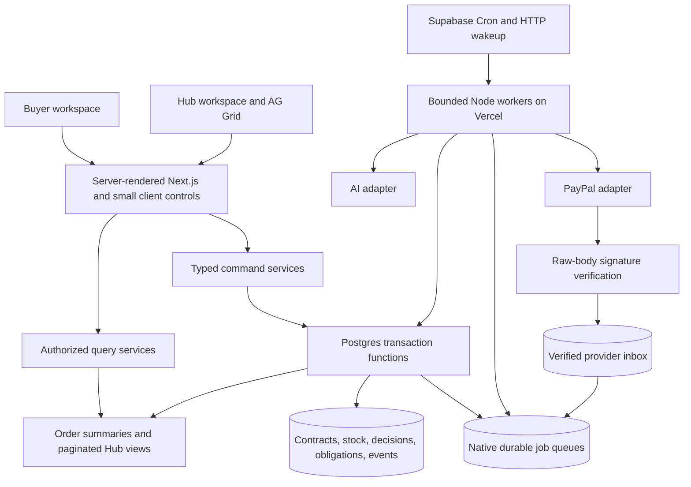

# Proposed 2.x architecture

Status: proposed design, not the deployed architecture. Baseline: `ce3d468`.

## One modular application, one authoritative database

Keep a modular Next.js/Node application and Supabase. Separate responsibilities in code rather than through new deployed services. Routes adapt commands; Postgres enforces invariants; adapters perform provider I/O; bounded workers advance durable work.



External API requests never run while stock/deal transaction locks are held. Provider effects and database commits are separate failure domains connected through durable operation records, stable request IDs, retries, and reconciliation.

## Module ownership

| Module | Owns |
| --- | --- |
| Contracts | Confirmed specification, quote, policy/FX versions, buyer consent |
| Planning | Bounded snapshots, feasible candidates, validation, selected plans |
| Payments | Provider operation lifecycle, signature verification, capture/refund proof |
| Inventory/quality | Atomic commitments, inspection evidence, accepted kg, quarantine |
| Recovery | Repair under the accepted contract and remaining authority budget |
| Finance/evidence | Currency-specific money facts, supplier obligations, exposure, trace links |
| Queries/UI | Authorized purpose-built views, freshness, understandable progress |

Refactor incrementally from `src/lib/domain`, `src/lib/ai`, `src/lib/recovery` and existing RPCs. Keep route URLs compatible during migration. Enforce server-only data modules. A new ORM/agent framework is not necessary for this design.

## Records that connect intelligence to execution

```ts
type ProcurementDecision = {
  id: string;
  requestId: string;
  specificationVersion: number;
  policyVersion: string;
  snapshotId: string;
  candidateSetHash: string;
  selectedPlanId: string;
  planHash: string;
  model: string;
  promptVersion: string;
  evidenceRefs: string[];
  expiresAt: string;
};

type ProcurementCommand = {
  commandId: string;
  dealId: string;
  expectedDealVersion: number;
  acceptedQuoteId: string;
  decisionId: string;
};

type CommerceJob = {
  operationId: string;
  scopeId: string;
  kind: string;
  expectedVersion: number;
  attempt: number;
  deadline: string;
};
```

These records are server-produced around validated model output. The model chooses a known candidate and cites supplied evidence. It cannot create authoritative stock identifiers, prices, permissions, or provider proof.

Store actual selected items and lot versions. A strategy label alone is insufficient. Hashes identify canonical content; they do not grant permission. Derive actor/scope on the server. A successful transaction writes commitments, allocations, event sequence, summary version, command receipt, and downstream jobs together.

## Protocol

1. Confirm a normalized buyer specification and version.
2. Obtain eligible free stock through SQL; persist bounded immutable snapshots and candidates.
3. AI selects a feasible candidate according to confirmed priorities. Validate and persist its selection/plan hash.
4. Quote acceptance binds that decision and policy. No prepayment reservation occurs.
5. Verify actual PayPal capture against the quote's exact amount/currency/merchant/deal.
6. Execute the selected stored plan, checking current stock and terms inside the transaction.
7. A changed stock snapshot causes explicit replan within accepted buyer terms. A new buyer price/specification requires explicit agreement.
8. Inspection determines accepted kg and obligations. Repair only the outstanding gap.
9. Settlement/handover and refund use the same authoritative facts; they are distinct outcomes.

Per-lot versions avoid invalidating every plan when unrelated stock changes. Freshness affects optimality; validation at commit determines safety. Cached negative feasibility requires a current check before becoming an authoritative refusal.

## Native queue and outbox

Use PGMQ as the transactional outbox transport: enqueue inside the same SQL transaction as the business change. Avoid a second independent broker write. Store business receipts/events outside the queue as the effect audit.

Queue delivery/visibility is not globally exactly-once business execution. Acknowledge/archive after committing the result; redelivery checks its receipt. Use fencing tokens so an expired worker cannot overwrite a newer result. [Supabase Queues](https://supabase.com/docs/guides/queues)

Separate payment/reconciliation, AI planning, and projection classes with small concurrency caps. Browser polling observes work; it is never the sole driver. Supabase Cron/pg_net can wake bounded Vercel Node workers. Vercel Hobby cron's daily interval does not support the proposed frequent recovery schedule. Verify secrets, frequency, quotas, and runtime limits before enabling the worker path. [Supabase Cron](https://supabase.com/docs/guides/cron), [Vercel cron limits](https://vercel.com/docs/cron-jobs/usage-and-pricing)

## Strong writes and fast reads

Small order summaries update in the command transaction. Larger Hub rollups may be asynchronous and must expose their version/as-of/lag. Authorization precedes role-specific serialization.

Payment, free-stock, command-authority, and settlement checks always use current transactional truth. Public marketing/policy descriptions may be cached. Private summaries require explicit scope/version keys; anonymous shared caches never hold owner output. AI reuse requires matching spec, policy, model/prompt version, evidence, and scope, then fresh execution validation.

Ship ETag/cursor polling with backoff first. Optional private Realtime Broadcast contains only an order/version hint, followed by an authorized refetch. Current guest cookies do not by themselves authorize a Realtime channel; scoped channel credentials/access must be implemented before switching transport.

Use Server Components/Suspense for initial reads and small Client Components for forms, PayPal, and the Hub grid. Follow installed Next.js 16.4 documentation, including Cache Components. Read cookies outside shared cache scopes. Local reference: `node_modules/next/dist/docs/`.

## Native PayPal verification

PayPal documents local signature verification over the original body using the certificate and CRC32. Standard Node crypto and a tested CRC32 library can remove a warm per-event verification API round trip. This is a documented platform feature, not a new cryptographic scheme. [PayPal verification](https://developer.paypal.com/api/rest/webhooks/rest/)

Validate certificate HTTPS origin/path/redirects, certificate validity, algorithm, raw bytes, and configured webhook ID. Cache certificates within validity; report cold-fetch time. Compare against postback verification and official vectors before adoption. Do not copy sample logging of full headers/payloads.

A signature authenticates an event. Correlate it to the recorded provider operation and invoke the same canonical capture/refund verifier and transition service as callbacks/reconciliation. Verify before deduplicating a trusted event ID; unauthenticated data must not poison the verified inbox.

Persist operation-specific UUID provider keys and retry deadlines. Endpoint-specific idempotency retention governs retries; uncertainty outside the safe window requires review rather than a new charge key. [PayPal idempotency](https://developer.paypal.com/api/rest/reference/idempotency/)

## Deployment and resource boundaries

Read-only inspection: PostgreSQL 17.11, `max_connections=60`, pg_stat_statements installed; pgmq, pg_cron and pg_net available but uninstalled. This establishes capabilities to validate, not measured throughput or unlimited quotas.

Retain HTTP/RPC database access initially. Benchmark direct pooled SQL only if RPC/network overhead remains material. Serverless direct pools need a tight per-instance cap and transaction-pool compatibility; an in-memory singleton does not cap the whole deployment. [Supabase connections](https://supabase.com/docs/guides/database/connecting-to-postgres)

Verify the deployed function region, then measure colocation with the Ireland database region. Keep static delivery global and authoritative stock writes regional. Do not assume the deployment currently uses Vercel's default region. [Vercel regions](https://vercel.com/docs/regions)

Use `SKIP LOCKED` for queue consumers. Stock commits use stable lock order, bounded timeouts, and explicit contention/replan outcomes. Skipped locked lots are not evidence of insufficient inventory. [PostgreSQL 17 SELECT](https://www.postgresql.org/docs/17/sql-select.html)

## Scale decisions deferred until evidence

Active-active inventory writes, Kafka, Redis, a vector database, Kubernetes, and a full event-sourcing rewrite are unnecessary for this release. The native design still has real connection, CPU, queue, provider, and cost boundaries. Larger compute or additional services require a measured bottleneck and a rollback plan.

