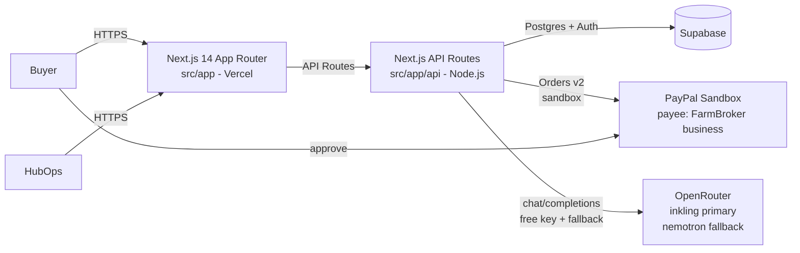

# System Architecture

## Components

## Boundaries

- Browser gets ONLY `NEXT_PUBLIC_*` (PayPal client ID, Supabase URL + publishable key, app URL). Secrets (`PAYPAL_SECRET`, `SUPABASE_SECRET_KEY`, `AI_API_KEY`) are server-only in API routes.
- Money flows Buyer → Platform only (PayPal purchase_units payee = FarmBroker business sandbox). Suppliers are NEVER a PayPal payee in MVP; settlement is calculated + labeled `Ready for PayPal Payout`.
- AI calls are server-only, same JSON schema as deterministic fallback, 8s timeout, max 1 call/screen, cached per requestId (P3 Real AI + demo reliability).

## Environments

- Local: `http://localhost:3000` + `.env.local`. Production: `https://farmbroker-aii.vercel.app` + Vercel env (Production + Preview). `main` branch = production.

---
*Stack frozen: Next.js / Node.js / Supabase / AI best-free-key (OpenRouter) / PayPal Sandbox (USD) / Vercel. No changes later.*
