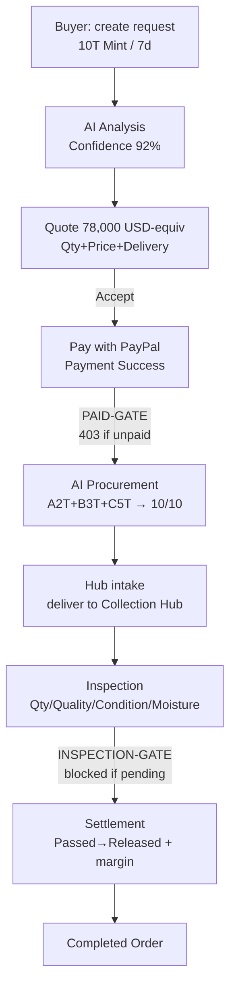

# User Flow (buyer lane vs hub lane)

## Lanes

- **Buyer lane** (`/request`, `/quote`, `/pay`, buyer dashboards): aggregates only — Order Status, Confidence, Expected Delivery, Payment Status. ZERO supplier names/contacts. Sees `FarmBroker Supply Network`.
- **Hub lane** (`/hub/*`, internal ops): Supplier A/B/C tables, intake forms, inspection grading, import/reset. Never linked from buyer CTAs.

## Gates (executable constitution)

- PAID-GATE: `POST /api/procure` → 403 unless `deal.status === 'paid'` (GR#3 Money first).
- INSPECTION-GATE: `POST /api/settle` → 403 unless quality done on all allocations (STEP 10 after inspection only).

---
*Stack frozen: Next.js / Node.js / Supabase / AI best-free-key (OpenRouter) / PayPal Sandbox (USD) / Vercel. No changes later.*
